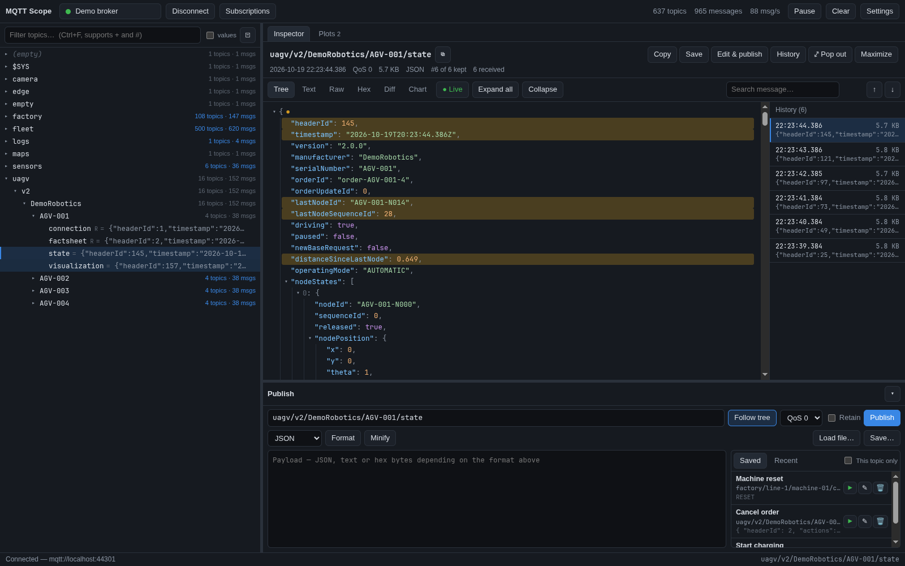
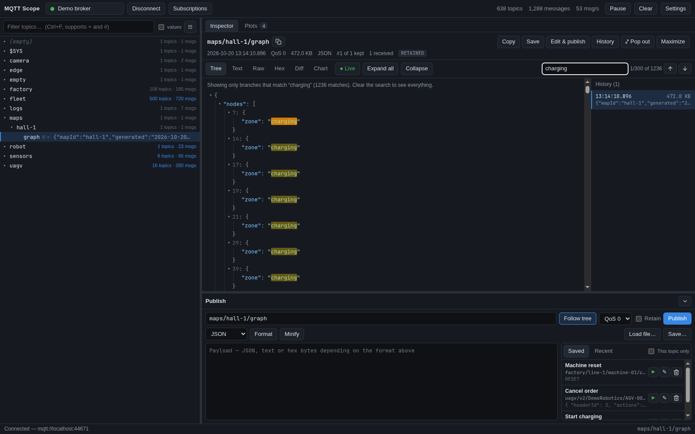
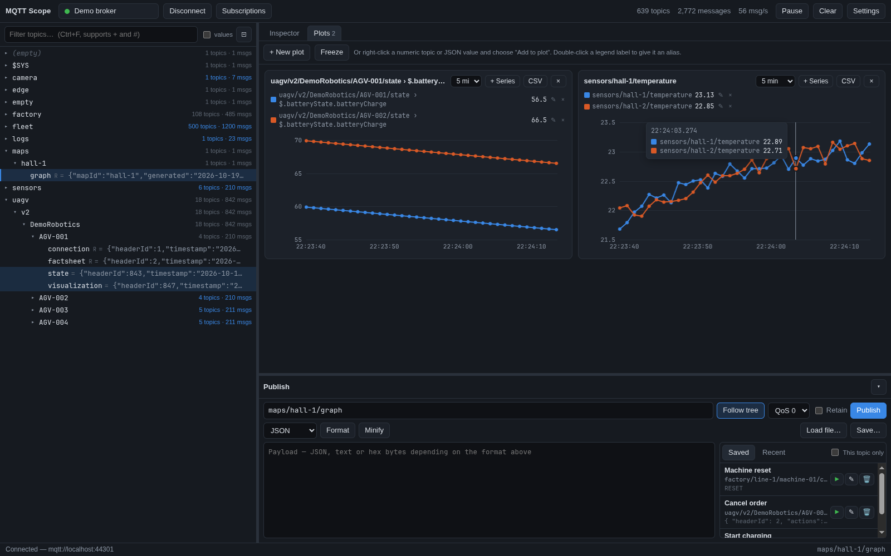
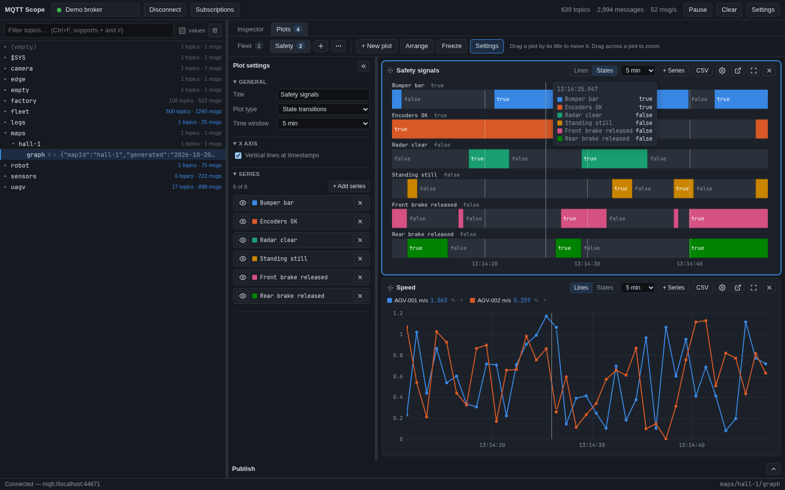
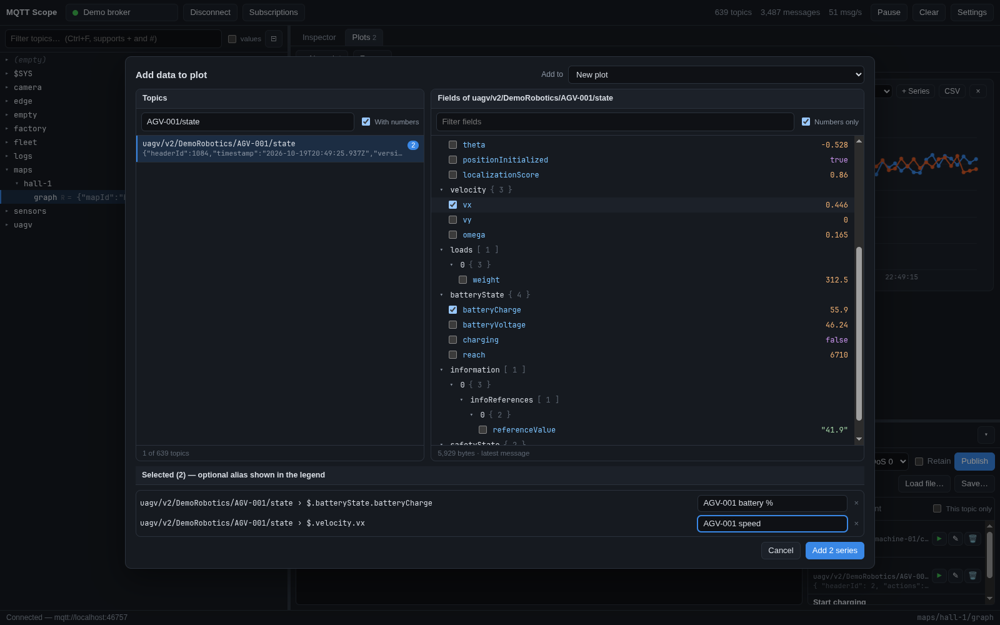
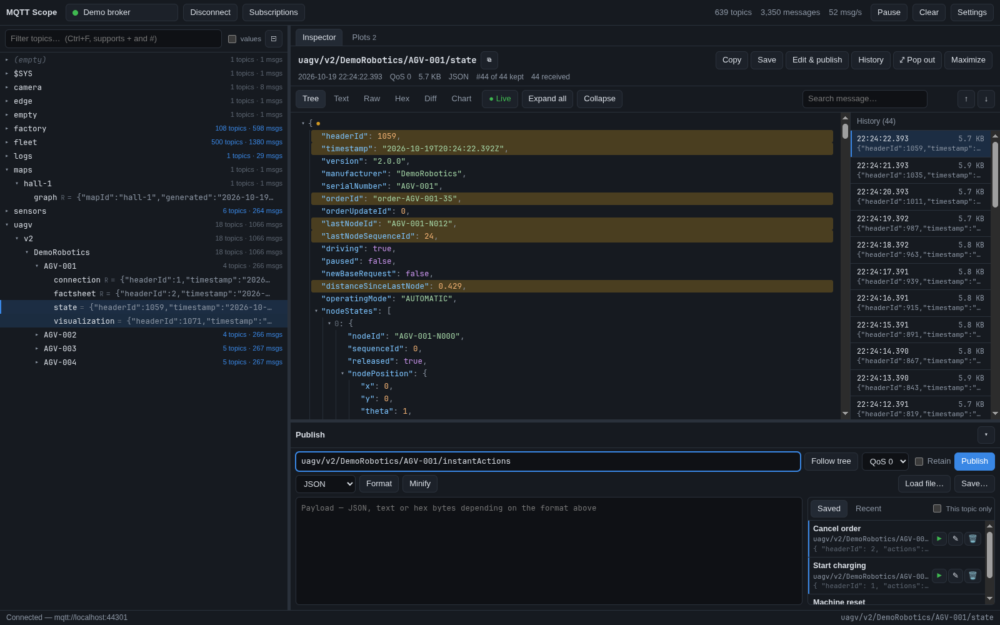

# MQTT Scope

[](https://github.com/ToRexZ/mqtt-scope/actions/workflows/ci.yml)
[](https://github.com/ToRexZ/mqtt-scope/releases/latest)
[](LICENSE)

Desktop MQTT client for inspecting busy brokers: an auto-subscribed live topic
tree, a large message inspector, live plots, and a publisher with a library of
saved messages. Runs on Linux, Windows and macOS.

**[Website](https://torexz.github.io/mqtt-scope/)** · **[Download the latest release](https://github.com/ToRexZ/mqtt-scope/releases/latest)** · **[Changelog](CHANGELOG.md)**



## Features

**Connections**
- Save any number of broker connections: `mqtt://`, `mqtts://` (TLS, custom CA,
  client certificates), `ws://`, `wss://`; MQTT 3.1.1 or 5.0; username/password;
  client ID; keep-alive; clean session.
- Each connection has its own subscription list (default `#` and `$SYS/#`), so
  the tree fills automatically. **Subscriptions…** adds or removes filters on the
  live connection, optionally saving the change to the connection.
- **Several brokers at once**: Ctrl+Shift+N (or start the app again) opens
  another window with its own connection. Saved connections, messages and plots
  are shared between windows.
- Passwords are encrypted with the operating system keychain when one is
  available; the connection dialog says when it is not.

**Topic tree**
- Every topic level is a node with live message and topic counts. Topics flash
  when they update.
- Virtualised: stays smooth with tens of thousands of topics.
- Filter by substring or MQTT wildcard (`fleet/+/heartbeat`, `sensors/#`),
  optionally also searching payloads.
- Right-click: copy topic or value, publish to the topic, open in its own
  window, add to a plot, hide, delete retained message(s) for a topic or a
  whole branch. Deleting is only offered for topics that were received as
  retained, and the confirmation lists every topic.
- Pause freezes the view and queues incoming messages (the newest 200,000 /
  256 MB are kept; anything older is counted as dropped).

**Inspector**
- Views: collapsible JSON **Tree** (fields that changed since the previous
  message are highlighted), syntax-highlighted **Text** with line numbers,
  **Raw**, **Hex**, structural **Diff** against the previous message, and
  **Chart** of a numeric payload or JSON field.
- Live updates keep your scroll position and expanded nodes. **Held** freezes
  the view on one message while new ones keep arriving (press **Space** to hold
  and release); pick any message from the history list (it holds still while
  the mouse is over it).
- Integers larger than 2^53 (64-bit ids, nanosecond timestamps) are shown
  exactly in Text and Raw and kept exact when re-publishing; the Tree view warns
  that it rounds them.
- Search: in the Tree view it filters a large JSON document down to the
  matching branches.
- Big messages: multi-megabyte JSON opens instantly (children are rendered on
  demand). **Maximize** (F11) gives the inspector the whole window; **Pop out**
  opens a topic in a separate live window.
- MQTT 5 metadata: content type, response topic, user properties.



**Plots**
- **+ New plot** (or **+ Series** on a plot, or right-click a topic → *Choose
  values to plot…*) opens a picker: a scrollable, filterable list of topics on
  the left; the structure of the selected message on the right with a checkbox
  next to every number. Pick values from several topics at once.
- **Tabs**: organise plots in named tabs (e.g. *Safety*, *Motion*), each with
  its own plots and layout. Data is collected for every tab, so switching shows
  the full timeline. Double-click a tab to rename it; right-click (or **⋯**) to
  duplicate, delete, or export/import it as a `.json` file to share.
- Plots **fill the tab** and are arranged like Lichtblick's panels: **drag a
  plot by its title** onto the edge of another plot to put it beside, above or
  below it, onto its middle to swap the two, or onto another tab to move it
  there (Esc cancels). Drag the gaps between plots to **resize** them
  (double-click a gap to even them out); a plot never gets so small that its
  lanes overlap — below that the tab scrolls. **Arrange** lays them out in rows
  again (a few stacked, or 1–4 per row).
- **Pop out** a plot into its own window (move it to another screen, resize
  it); it keeps plotting live and has its own plot type, time window, freeze
  (**Space**) and zoom. **Ctrl+R** in the main window restarts it too.
  **Full screen** shows one plot on its own (Esc leaves).
- **State transitions**: switch a plot from *Lines* to *States* and every
  series becomes a labelled lane that changes colour when its value changes
  (true/false, or shades with the value written in), with the current value
  next to the label. Plots of booleans start in this mode. In a *Lines* plot,
  single series can still be drawn as a state lane below the y-axis.
- **Zoom**: drag across a plot to zoom into that time range (all plots in the
  tab follow) and, when you drag a box, that value range. Double-click, Esc or
  **Reset view** (on each zoomed plot, and in the toolbar) returns to the live
  view.
- **Vertical lines at timestamps** (like Lichtblick's time grid) run through
  the data and the state lanes; turn them off per plot in the settings panel
  (X axis).
- A **settings panel** for the selected plot, laid out like Lichtblick's:
  title (rename), plot type, time window, legend on/off and values, fixed or
  automatic y-axis range, timestamp lines, and per series: visibility, label
  (alias), **colour picker** or palette colour, display style (line, line and
  points, steps, state lane) and line width. Hide it with « (» brings it back)
  and resize it by dragging its edge.
- **Synced time bar**: hovering one plot moves the time bar on every plot and
  shows the values at that moment in each legend.
- Quick add: right-click a numeric topic, or a number in the inspector's Tree
  view, → *Add to new plot* / *Add to plot “…”*. Up to 8 series per plot,
  freeze (**Space**), CSV export (time, series alias, topic, path, value).







**Publisher**
- JSON (validated, format/minify), text or hex-byte payloads; QoS; retain;
  Ctrl+Enter to send; load a payload from a file.
- **Saved messages**: store frequently sent messages (name + topic + payload +
  options). Messages for the selected topic are listed first; ▶ sends one with a
  single click. A **Recent** list keeps the last 50 publishes.
- Safety for live systems: the topic follows the tree selection only until you
  edit the message (**Follow tree** turns it back on); Retain is never copied
  from received messages and resets when the topic changes; retained publishes
  ask for confirmation; a publish in flight blocks repeats (double clicks, held
  Ctrl+Enter); topics containing `+` or `#` are refused.



## Install

Download the file for your platform from the
[releases page](https://github.com/ToRexZ/mqtt-scope/releases/latest):

| Platform | File |
|---|---|
| Linux | `MQTT-Scope-<version>-linux-x86_64.AppImage` (`chmod +x` and run) or `…-linux-x64.tar.gz` |
| Windows | `MQTT-Scope-<version>-win-x64-setup.exe` (installer) or `…-win-x64-portable.exe` |
| macOS | `MQTT-Scope-<version>-mac-arm64.dmg` (Apple silicon) or `.zip` |

**Arch Linux**: `yay -S mqtt-scope-bin` once the AUR package is published; until
then build the package from the release's `PKGBUILD` and `mqtt-scope.desktop`:

```sh
mkdir -p ~/.cache/mqtt-scope-pkg/latest && cd ~/.cache/mqtt-scope-pkg/latest && curl -fLO https://github.com/ToRexZ/mqtt-scope/releases/latest/download/PKGBUILD -fLO https://github.com/ToRexZ/mqtt-scope/releases/latest/download/mqtt-scope.desktop && makepkg -sic
```

The AppImage needs FUSE 2 (`sudo pacman -S fuse2` on Arch, `sudo apt install
libfuse2` on Ubuntu 22.04+); without it run it with
`APPIMAGE_EXTRACT_AND_RUN=1`, or use the `.tar.gz`.

So that GNOME shows its icon in the dock, the AppImage adds itself to the app
menu when it starts: `~/.local/share/applications/mqtt-scope.desktop` and
`~/.local/share/icons/hicolor/*/apps/mqtt-scope.png` (not when the Arch
package, AppImageLauncher or Gear Lever already provide an entry). Once the
AppImage is deleted the entry disappears from the menus; delete those files
as well to remove it completely (the AppImage writes them again whenever it
starts). Switching to the Arch package: the AppImage removes its entry the
next time it starts; if you delete the AppImage before that, delete
`~/.local/share/applications/mqtt-scope.desktop` yourself, or it hides the
package from the menus.

Builds are not code-signed yet: on macOS right-click → Open the first time; on
Windows choose "More info → Run anyway".

**Verify a download** (releases after 0.2.0): every release file has a signed
[build attestation](https://docs.github.com/en/actions/how-tos/secure-your-work/use-artifact-attestations/use-artifact-attestations)
showing it was built by this repository's CI from the tagged commit:

```sh
gh attestation verify MQTT-Scope-<version>-linux-x86_64.AppImage --repo ToRexZ/mqtt-scope
```

## Updates

MQTT Scope checks GitHub for a newer release at startup and every 6 hours
(switch it off in **Settings → General → Check for updates**). When there is
one, an **Update x.y.z** button appears in the top bar and opens a panel with
the release notes. **Later** closes it; **Skip this version** hides that
version until a newer one comes out. **Settings → Check for updates** (at the
bottom of the dialog; on macOS also Help → Check for Updates…) always asks,
is the only check that says "latest version" or reports an error (automatic
checks stay silent, e.g. when offline), and un-skips a skipped version.

What the button does depends on how you installed:

| Install | Update |
|---|---|
| AppImage, Windows installer | **Download update**, then **Restart to update** (asks first if brokers are connected). A downloaded update you did not restart into installs when you quit. |
| `.tar.gz`, Windows portable, macOS | **Download** opens the release page. |
| Arch package | The panel shows a command to copy and paste into a terminal. |

On **Restart to update** every main window shows an *Installing MQTT Scope
x.y.z* dialog with a moving progress bar until the app closes. On Windows the
installer's own window then shows the install's progress, and MQTT Scope opens
again in front when it is done, about half a minute in all. A per-machine
installation asks for administrator rights first; declining leaves MQTT Scope
closed and not updated (start it again, and the notice comes back). With both
a per-user and a per-machine copy installed, the update goes to the
per-machine one. The AppImage restarts into the new version within seconds.
Installing on quit happens silently.

Tip: electron-updater replaces a versioned AppImage name
(`MQTT-Scope-0.3.0-linux-x86_64.AppImage`) with the new versioned name, which
breaks launchers and shortcuts that point at the old file. Rename it to e.g.
`MQTT-Scope.AppImage` for a stable path.

Privacy: automatic and manual checks make one request to GitHub's
latest-release API for ToRexZ/mqtt-scope. The app adds only the `Accept` and
`User-Agent` (`MQTT-Scope/<version>`) headers to it, and no identifiers or
cookies; the browser engine adds its standard headers (such as
`Accept-Language`). On the AppImage and the Windows installer, **Download
update** then has electron-updater (`User-Agent: electron-builder`) fetch
GitHub's release list for the repository, the latest release's update
description file (`latest-linux.yml` or `latest.yml`) and the new build (only
its changed blocks where it can). These requests carry no install identifier
either: electron-updater's staging ID header is the same all-zero value on
every install.

## Keyboard shortcuts

All shortcuts can be changed in **Settings → Keyboard** (click one and press the
new keys; clashes are flagged). Defaults (Ctrl is Cmd on macOS):

| Keys | Action |
|---|---|
| Enter | Connect to the selected connection (↑ ↓ choose it) |
| Ctrl+K | Connections |
| Ctrl+Shift+S | Subscriptions |
| Ctrl+Shift+N | New window (another broker) |
| Ctrl+, | Settings |
| Ctrl+F | Filter topics (or search the message when the inspector has focus) |
| Ctrl+Enter | Publish (in the publisher) |
| F11 | Maximize inspector (Esc restores) |
| Ctrl+1 / Ctrl+2 | Inspector / Plots |
| Ctrl+Shift+A | Add data to a new plot |
| Ctrl+Shift+P | Pause / resume |
| Space | Hold / follow the inspector's message (on the Plots tab: freeze / resume) |
| Ctrl+R | Reload: clear received messages and restart the plot timelines (stays connected) |
| Esc | Leave a full-screen plot, reset plot zoom, restore the inspector |
| ↑ ↓ ← → Enter | Navigate / expand the topic tree |
| Drag across / double-click a plot | Zoom / back to live |
| Drag a plot's title | Move the plot (Esc cancels) |
| Enter / Shift+Enter | Next / previous search match |

## Settings and data

Settings → General: messages kept per topic (default 100), history size per
topic (default 64 MB; the latest message is always kept), whether clicking a
topic in the tree also expands it one level (default on), and whether to check
for updates (default on). The bottom of the dialog shows the MQTT Scope
version and has **Check for updates**, **Show log file** and **Open data
folder**. There is no menu bar on Linux and Windows; the shortcuts that used to
live only in it still work (Ctrl+Q quit, Ctrl+Plus / Ctrl+Minus / Ctrl+0 zoom,
Shift+F11 full screen, Ctrl+Shift+I developer tools).

Data lives in the app data folder (Settings → Open data folder):
`profiles.json` (connections), `savedMessages.json`, `plotTabs.json` (plot
tabs; `plots.json` keeps the tab on screen in the 0.1 format for older
versions),
`settings.json`, `updates.json` (the version you skipped), `logs/main.log`. Set
`MQTTSCOPE_USER_DATA=/some/dir` to use a different folder (e.g. a portable
install).

## Development

Requires Node.js 22+.

```sh
npm install
npm run demo-broker   # local broker with simulated AGV / sensor / factory traffic on :1883 and ws :9001
npm start             # run the app
```

### Tests

```sh
npm run test:unit          # pure logic (node:test)
npm run test:integration   # MQTT session against an in-process broker: TCP, TLS, WebSocket, auth, reconnects
npm run test:e2e           # drives the real Electron app with Playwright (headless)
npm run lint               # ESLint
npm test                   # all of the above
```

The update notice's tests point the app at a local feed with
`MQTTSCOPE_UPDATE_URL` (serves `release.json`), pick the install type with
`MQTTSCOPE_UPDATE_KIND` (`appimage`, `nsis`, `portable`, `pacman`, `manual`) and
fake the download with `MQTTSCOPE_UPDATE_FAKE=1`. Without `MQTTSCOPE_UPDATE_URL`
an unpackaged run never contacts anything.

The MQTT 5 integration test runs against `eclipse-mosquitto:2` in Docker and is
skipped when Docker is unavailable.

### Packaging

```sh
npm run dist:linux   # AppImage + tar.gz
npm run dist:win     # NSIS installer + portable exe (build on Windows)
npm run dist:mac     # dmg + zip (build on macOS)
npm run verify:package   # launch the packaged app and check it connects
```

`build/installer.nsh` (the `nsis.include` in package.json) makes the Windows
installer skip its questions and Finish page when an update runs it with its
window, as Restart to update does from 0.3.0 on. Each version's installer is
run that way by the version before it, so keep it in the build config for every
later version (electron-builder fails the build if the file is missing; a unit
test checks the config and the hooks). After upgrading electron-builder, check
that its NSIS templates still call the `customInstallMode` and
`customFinishPage` hooks, and add no installer page that does not skip itself
on `--updated`.

The Linux builds take their icon from `build/icons/`, one PNG per icon theme
size. After changing `build/icon.svg`, regenerate them with
`for n in 16 32 48 64 128 256 512; do rsvg-convert -w $n -h $n build/icon.svg -o build/icons/${n}x${n}.png; done`.

CI (`.github/workflows/ci.yml`) runs the linter and all tests on every push and
pull request. Pull requests also build and smoke-test the installers on Linux,
Windows and macOS and build the Arch package from them, publishing nothing.

### Releasing

Add a section for the new version to [CHANGELOG.md](CHANGELOG.md) (move the
entries under *Unreleased* there, if any), then:

```sh
npm version patch        # or minor / major: bumps package.json and creates a v* tag
git push --follow-tags
```

The tag must equal `package.json`'s version, or CI fails the release. The tag
makes CI build installers on Linux, Windows and macOS, smoke-test each packaged
app, fill in the PKGBUILD for the tag and check the package builds from it (as
on every pull request), and attach everything to a GitHub Release
whose notes are the version's CHANGELOG section (`scripts/release-notes.mjs`)
plus the generated list of changes. Besides the installers the release carries
the update files (`latest*.yml`, `*.blockmap`), `PKGBUILD` and
`mqtt-scope.desktop`; their names are part of the updater's contract (installed
apps fetch them by name), so do not rename them. Installed Windows apps also
rely on the installer's update behaviour from `build/installer.nsh` (see
Packaging). `packaging/aur/PKGBUILD` in the repository is a template that CI
fills in per tag: do not edit `pkgver` or `sha256sums` by hand. CI pushes the
package to the AUR itself when the `AUR_SSH_PRIVATE_KEY` secret is set. Job
order: test, package, pkgbuild, release, aur (see the comment in
`.github/workflows/ci.yml`).

`node scripts/screenshots.mjs` regenerates the screenshots in `docs/`.

### Architecture

```
main/          Electron main process (CommonJS)
  main.js        windows (one MQTT session each; child windows for pop-outs), menu, IPC
  mqttSession.js an MQTT connection; batches messages every 50 ms for the UI
  profileStore.js, jsonStore.js   persisted data (atomic writes)
  updateCheck.js version compare, release parsing, install type, pacman command (pure)
  updater.js     update state: periodic checks, skip, download, restart
  updateEngine.js  downloads and installs for AppImage / Windows installer (electron-updater)
  afterUpdate.js   the window comes to the front when the Windows installer starts the new version
  fetchRelease.js  the one request a check makes: GitHub's latest release
  desktopIntegration.js  the AppImage's menu entry and icons, so GNOME shows its logo
  preload.js     the only API the UI can call (contextIsolation + sandbox)
renderer/      UI (plain ES modules, no framework or build step)
  app.js         wiring; topicTree.js data model; treeView.js virtual list
  viewer.js      inspector; jsonTree.js, jsonDiff.js, payload.js
  plots.js       Plots tab: wires the modules below and draws tabs and plot cards
    plotModel.js   tabs, plots and their arrangement: every rule, and the saved document (no DOM)
    plotData.js    points collected for each plotted series (no DOM)
    plotView.js    what a chart and legend show for a plot; plot sizes (no DOM)
    plotLayouts.js validation, migration, split-layout tree and tab file format (no DOM)
    mosaic.js      split layout on screen: resizing gaps, dragging plots around
    plotSettings.js  settings panel; plotPicker.js, fields.js  choosing values to plot
    chart.js, plotMath.js  drawing a plot; plotWindow.js  a plot in its own window
  updateView.js  what the update button, panel and Installing dialog show (no DOM); updateButton.js  draws them
  icons.js       monochrome line icons
  keys.js        keyboard shortcuts (defaults, rebinding, matching)
  publisher.js, connectionDialog.js, subscriptionsDialog.js, settings.js
test/          unit, integration, e2e (+ helpers: in-process broker, app launcher)
```

Payloads are untrusted: they are only ever inserted as text or escaped HTML,
the UI runs sandboxed with a strict Content Security Policy, and navigation
and new windows are blocked.

## License

[MIT](LICENSE) © 2026 Victor Risager
